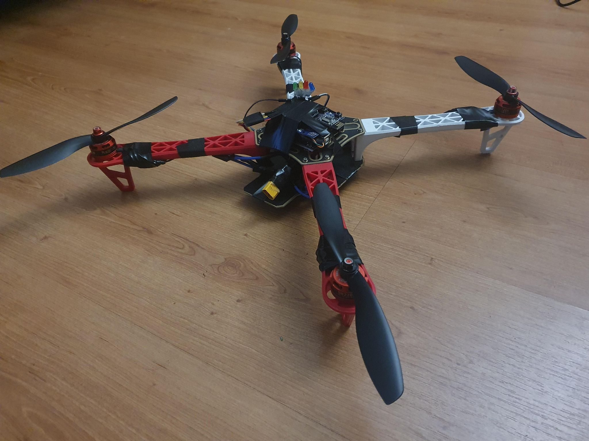

# Custom Quadcopter — Flight Controller, Transmitter & PID Firmware Built from Scratch

A complete quadcopter designed and built from bare components — F450 airframe, brushless powertrain, Arduino-based flight controller, and a hand-built ground-station transmitter around a PS3 controller and an nRF24L01+ radio. All firmware on both ends was written from scratch in C/C++: interrupt-driven motor control, MPU-6050 sensor fusion, and discrete PID attitude stabilization — no flight-stack libraries. The repository contains the two Arduino sketches: one for the on-board flight controller and one for the ground-station transmitter.



## Hardware

### Bill of materials

The build uses the following components. The microcontroller, IMU, radio, and motor pinout are the items I verified directly from the source code; the frame, motors, ESCs, battery, and controller are the parts I used for this particular build.

| Component | Part used | Verified in code |
|-----------|-----------|------------------|
| Flight microcontroller | Arduino Uno (ATmega328P) | `PORTD`/`DDRD` bit manipulation for motor pins; 16 MHz loop timing |
| IMU | GY-521 breakout (MPU-6050) | `gyro.cpp`: I2C address `0x68`, gyro configured to ±1000 deg/s, accel to ±8 g |
| Radio (air side) | nRF24L01+ or nRF24L01+ PA/LNA | `radio_nrf24.cpp`: CE on D7, CSN on D8, IRQ on D2, address `0xB00B1E5000LL` |
| Radio (ground side) | nRF24L01+ or nRF24L01+ PA/LNA | `Transmitter_Station_Software_V3.0/radio_nrf24.cpp`: CE on D7, CSN on D8 |
| Motors | Racerstar RE 2205 2300 kV brushless | Driven by 1000–2000 µs servo PWM on pins D3–D6 |
| ESCs | Racerstar RS20Ax4 20 A BLHeli_S 4-in-1 | See motor PWM mapping above |
| Frame | ShareGoo F450 450 mm quadcopter frame | — |
| Battery | GOLDBAT 5000 mAh 30 C 3S LiPo | — |
| Ground controller | Sony PS3 controller | `PS_3.cpp`: read over USB via `PS3USB.h`, analog sticks mapped to 1000–2000 |
| LEDs (status) | 4 LEDs on analog pins A0–A3 | `led_.cpp`: blue A0, red A1, yellow A2, green A3 |

### Pin mapping (flight controller)

| Pin | Function | Code reference |
|-----|----------|----------------|
| A0 | Blue status LED | `led_.cpp` |
| A1 | Red status LED | `led_.cpp` |
| A2 | Yellow status LED | `led_.cpp` |
| A3 | Green status LED | `led_.cpp` |
| D2 | nRF24 IRQ input | `radio_nrf24.cpp` |
| D3 | ESC 4 / motor 4 | `Motor_controller.cpp` |
| D4 | ESC 3 / motor 3 | `Motor_controller.cpp` |
| D5 | ESC 2 / motor 2 | `Motor_controller.cpp` |
| D6 | ESC 1 / motor 1 | `Motor_controller.cpp` |
| D7 | nRF24 CE | `radio_nrf24.cpp` |
| D8 | nRF24 CSN | `radio_nrf24.cpp` |
| SDA/SCL | MPU-6050 I2C | `gyro.cpp` |

## Software architecture

### Flight controller loop (`Flight_Controller_Software_V3.0/`)

The flight controller runs a fixed 250 Hz loop (4000 µs per iteration) on the Arduino Uno:

1. **IMU read** — `gyro_c.read_Imu()` reads 14 bytes from the MPU-6050 over I2C (accel X/Y/Z, temperature, gyro X/Y/Z). After 3000-sample calibration, gyro bias offsets are subtracted.
2. **Attitude estimation** — `gyro_c.the_Gyroscope()` integrates gyro rates into roll/pitch/yaw angles and fuses them with accelerometer angles through a complementary filter (`alpha_gyro = 0.95`, `alpha_acc = 0.05`).
3. **Setpoint generation** — `PID_c.PID_Init()` converts the PS3 stick values received over the radio into roll, pitch, yaw, and thrust setpoints, with deadbands to ignore joystick drift.
4. **PID stabilization** — `PID_c.PID_Controller()` computes discrete PID corrections for roll, pitch, and yaw. Integral terms are clamped to ±400 and the final outputs are clamped to ±400.
5. **Motor mixing** — `Motor_c.e_Driver()` mixes thrust and PID outputs into four ESC pulse widths:

   ```text
   mESC1 = base + thrust + roll - pitch - yaw
   mESC2 = base + thrust - roll - pitch + yaw
   mESC3 = base + thrust - roll + pitch - yaw
   mESC4 = base + thrust + roll + pitch + yaw
   ```

   Each output is constrained between 1050 µs and 1750 µs.
6. **ESC output** — `Motor_c.motor_drive()` writes the pulse widths to the four ESCs using the Arduino `Servo` library on pins D3–D6. If the radio link is lost, the motors are sent 1000 µs (disarmed).

A state machine (`quad_state`) handles startup, arming, and failsafe behavior; the exact states are managed by the `State_controller` referenced in the main sketch.

### Transmitter station (`Transmitter_Station_Software_V3.0/`)

The ground station runs on a separate Arduino and bridges the PS3 controller to the airframe:

1. **PS3 input** — `PS3_c.read_PS3()` polls a USB-connected PS3 controller using the `PS3USB` library. Left/right analog sticks and face buttons are read.
2. **Mapping** — Stick values are mapped from 0–255 to 1000–2000, with center deadbands so the rest position maps to 1500.
3. **Radio output** — `rfRadio_c.radio_tx()` packs the data into a `controllerStruct` and transmits it over the nRF24L01+ at 1 Mbps on the shared address `0xB00B1E5000LL`.

### Radio link

Both halves use the RF24/nRF24 library and the same 5-byte pipe address `0xB00B1E5000LL`:

- **Air side**: configured as a receiver (`openReadingPipe`, `startListening`) with an interrupt on D2 that copies the received `controllerStruct` into `controllerData`.
- **Ground side**: configured as a transmitter (`openWritingPipe`, `stopListening`) that sends the same `controllerStruct` every loop.
- **Failsafe**: if no packet arrives, the flight controller zeros the setpoints (`radio_online == false`) and drives the ESCs to 1000 µs.

## Build and upload

1. Install the Arduino IDE (the project was written for the legacy Arduino toolchain circa 2021).
2. Install the required libraries:
   - **Flight controller**: `Wire`, `Servo`, and an nRF24 library (`RF24` or `nRF24` depending on the local copy of `radio_nrf24.cpp`). `PinChangeInterrupt` is also included for the radio interrupt.
   - **Transmitter**: `USB Host Shield library 2.0` (for `PS3USB.h`) and the same nRF24 library as the flight controller.
3. Connect the hardware according to the pin mapping table.
4. Open `Flight_Controller_Software_V3.0/Flight_Controller_Software_V3.0.ino`, select **Arduino Uno**, and upload.
5. Open `Transmitter_Station_Software_V3.0/Transmitter_Station_Software_V3.0.ino` on the second Arduino, select the appropriate board, and upload.
6. Power on the transmitter first, then the flight controller. The 5-second startup delay in the flight controller gives the IMU time to settle before the main loop begins.

## Safety notes

- Remove or secure the propellers whenever the quadcopter is powered on the bench. A 5000 mAh 3S LiPo driving 2300 kV motors can cause serious injury.
- Verify that the ESCs initialize to 1000 µs and that the motors do not spin until the radio link is established and the throttle stick is raised.
- The PID gains in this firmware were tuned for this specific frame, battery, and motor combination. Re-tune before flying any hardware changes.
- The code does not include a GPS hold, altitude hold, or obstacle-avoidance system; it is a manual-rate/attitude stabilizer only.
- Always fly in an open area away from people, animals, and property, and comply with local aviation regulations.

## Repository layout

```text
Quadcopter-Design-Project-V3.0/
├── Flight_Controller_Software_V3.0/   # On-board flight controller Arduino sketch
├── Transmitter_Station_Software_V3.0/ # Ground-station transmitter Arduino sketch
├── Images/                            # Hardware photos
└── README.md                          # This file
```
